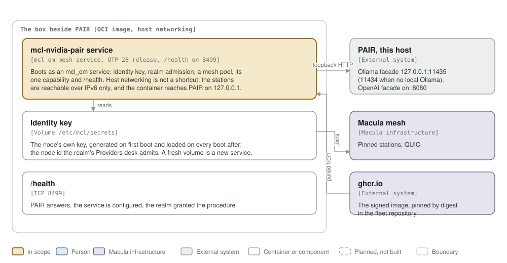

# mcl-nvidia-pair architecture

This exists so a member of a Macula realm, on another machine, can use a
household's own NVIDIA PAIR inference cluster through the mesh, and nobody
outside the realm can.

The model follows [C4](https://c4model.com): context, containers, components.
The diagrams are generated by `architecture/c4_diagrams.py` into `assets/`;
change the script, run it, and look at the result before committing.

## Level 1: system context

| Element | Role |
|---------|------|
| mcl-nvidia-pair | An `mcl_om` mesh service with one procedure, `mcl-nvidia-pair/chat`. It builds its own outbound request and relays no caller-supplied path, so PAIR's admin surface is not reachable from the realm. |
| Realm member | Calls `chat` from anywhere with the membership UCAN the realm issued to that node. The tier is checked: `member/email-verified` by default. |
| macula-realm | Issues the membership UCAN the gate verifies offline, and the `org_directory` + `procedure_delegation` that authorise this service to advertise at all. |
| PAIR Ollama facade | NVIDIA PAIR's own Ollama- and OpenAI-compatible HTTP on this host, in front of the engines it adopted. The bridge talks to the facade, never to the engine behind it. |
| PAIR cluster | The household's own machines. PAIR routes, schedules and fails over inside it, unchanged; this repository does not touch that. |
| Macula mesh | Stations carry the call; the DHT carries the advertisement a caller resolves. |

## Level 2: containers

One OTP 28 release in one image, run with host networking on the box beside
PAIR. Host networking is not a shortcut: the stations are reachable over IPv6
only, and the container reaches PAIR's facade on the host's own `127.0.0.1`.

What `mcl_om` provides: the node identity key on the volume at
`/etc/mcl/secrets`, realm admission, the mesh pool, the boot claim an operator
admits on the realm's Providers desk, and `/health` on TCP 8499. What this
service adds: the one capability, the limiter, and the forward to PAIR.

The identity volume is the node. Recreating the container on the same volume
keeps the node id the realm admitted; a fresh volume is a new service that must
be admitted again.

## Level 3: components

| Component | What it does |
|-----------|--------------|
| `mcl_nvidia_pair_service` | The six `mcl_om_service` callbacks. One capability, `chat`, with `auth => {realm_member_required, RealmKeyId, RequiredCan}`: the realm key id is derived from the same `realm_key` mcl_om pins as the trust anchor, so the gate and the anchor cannot name two realms. Announces nothing without a realm key, because this forwards onto someone's own hardware. |
| `mcl_nvidia_pair_mesh_rpc` | The `macula_response` handler. Folds the payload to one shape, takes the wire-authenticated `caller` macula merges in, asks the limiter, forwards. Macula verifies the UCAN before this runs, so no token is parsed here. |
| `throttle_pair_callers` | Fixed-window per caller in ets, atomic `update_counter`, a refused call still counting (fail-closed). `max_per_window` and `window_seconds` come from `PAIR_MAX_PER_WINDOW` / `PAIR_WINDOW_SECONDS`; the image ships 20 per 60 s. |
| `chat_to_pair` | Builds the outbound request itself — `POST <facade>/v1/chat/completions` — and parses `choices[0].message.content`. `probe/0` is `/v1/models`, which is what `/health` reads for "PAIR answers". |
| `mcl_nvidia_pair_sup` | One permanent child, the limiter. Health is `health_of/2` over the advertised capabilities and the PAIR probe, so a bridge nobody can reach reads degraded rather than healthy. |

### What a refusal is

Two different refusals, deliberately not collapsed:

- **Not a member, or the wrong tier.** Macula refuses the call before the
  handler runs, with its own BOLT#4 `unauthorized` code. Nothing reaches PAIR
  and nothing is counted.
- **Over the limit.** The handler answers `rate_limited`, and the call did
  count: retrying a refused call is not a way to spend more than the budget.
