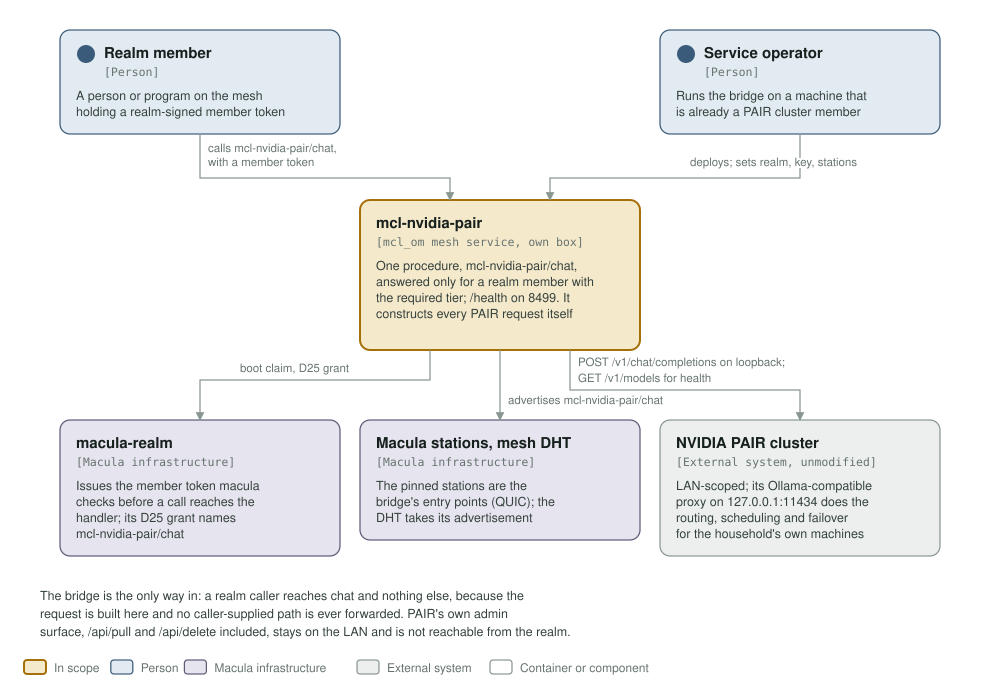
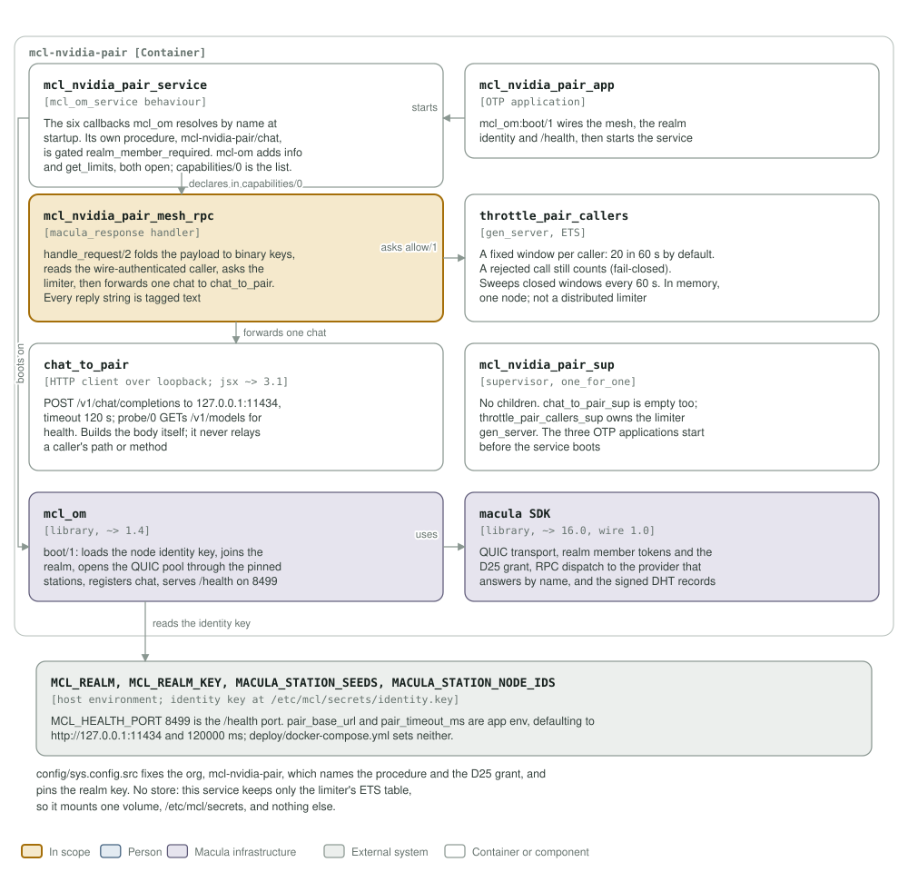

# mcl-nvidia-pair architecture: C4 model

*This exists so a reader can see what mcl-nvidia-pair talks to, and what it is
made of, without reading it.*

**Status: a tested skeleton, never yet in service.** One procedure,
`mcl-nvidia-pair/chat`, is built and unit-tested with PAIR and the mesh stood
in for; it has never forwarded a live request from the mesh to a real PAIR
cluster, no realm member has passed its gate end to end, and it is not deployed
anywhere. `/health` on 8499 reports the PAIR probe and whether the service is
configured to serve at all.

## Level 1: system context

| Element | Kind | Role |
| --- | --- | --- |
| mcl-nvidia-pair | In scope | One procedure, `mcl-nvidia-pair/chat`, answered only for a realm member carrying the required tier; `/health` on 8499. It builds every request to PAIR itself |
| Realm member | Person | A person or program on the mesh holding a realm-signed member token. Its call is checked by macula before the handler runs |
| Service operator | Person | Runs the bridge on a machine that is already a member of the PAIR cluster, and supplies the realm, its public key and the pinned stations |
| macula-realm | Macula infrastructure | Issues the member token macula checks before a call reaches the handler; its D25 grant names `mcl-nvidia-pair/chat` for this node |
| Macula stations, mesh DHT | Macula infrastructure | The bridge dials out to the pinned stations over QUIC, and the mesh DHT takes the capability it advertises |
| NVIDIA PAIR cluster | External system | Unmodified and LAN-scoped; its Ollama-compatible proxy on `127.0.0.1:11434` does the routing, scheduling and failover for the household's own machines |

The bridge is the only way in: a realm caller reaches `chat` and nothing else,
because the request is built here and no caller-supplied path is ever
forwarded. PAIR's own admin surface, `/api/pull` and `/api/delete` included,
stays on the LAN and is not reachable from the realm.

## Level 2: containers and components

| Component | Technology | Responsibility |
| --- | --- | --- |
| `mcl_nvidia_pair_service` | Erlang, the `mcl_om_service` behaviour | The six callbacks `mcl_om` resolves by name at startup. One capability, `chat`, gated `realm_member_required` with the realm key id and the tier `member/email-verified` by default. `identity_spec/0` claims no topic authority |
| `mcl_nvidia_pair_app` | OTP application | `mcl_om:boot/1` wires the mesh, the realm identity and `/health`, then starts the service. There is no store |
| `mcl_nvidia_pair_mesh_rpc` | Erlang, the `macula_response` behaviour | `handle_request/2` folds the payload to binary keys, reads the wire-authenticated `caller`, asks the limiter, then forwards exactly one chat to `chat_to_pair`. Every reply string is tagged text |
| `throttle_pair_callers` | gen_server, ETS | A fixed window per caller, 20 calls in 60 s by default. A rejected call still counts (fail-closed), closed windows are swept every 60 s, and the table is in memory on one node, not a distributed limiter |
| `chat_to_pair` | Erlang, `httpc` and `jsx` | `POST /v1/chat/completions` to `127.0.0.1:11434`, timeout 120 s by default; `probe/0` GETs `/v1/models` for health. It builds the body itself and never relays a caller's path or method |
| `mcl_nvidia_pair_sup` | supervisor, `one_for_one` | Supervises this service's own processes, and has no children. `chat_to_pair_sup` is empty too; `throttle_pair_callers_sup` owns the limiter gen_server. The three OTP applications start before the service boots |
| `mcl_om` | library, `~> 1.4` | `boot/1`: loads the node identity key, joins the realm, opens the QUIC pool through the pinned stations, registers `chat`, and serves `/health` on 8499 |
| macula SDK | library, `~> 16.0`, wire 1.0 | QUIC transport, realm member tokens and the D25 grant, RPC dispatch to a provider that answers by name, and the signed records the mesh DHT holds |
| Host environment | environment | `MCL_REALM`, `MCL_REALM_KEY`, `MACULA_STATION_SEEDS` and `MACULA_STATION_NODE_IDS` are required; `MCL_HEALTH_PORT` is 8499. The identity key is at `/etc/mcl/secrets/identity.key` |

`config/sys.config.src` fixes the org, `mcl-nvidia-pair`, which names the
procedure and the D25 grant, and pins the realm key. `pair_base_url` and `pair_timeout_ms` are application env with defaults in
`chat_to_pair`, `http://127.0.0.1:11434` and 120000 ms;
`deploy/docker-compose.yml` sets neither. The service keeps no store, so it
mounts one volume, `/etc/mcl/secrets`, and nothing else.

**Where the station list comes from.** It is not in `config/sys.config.src`: `mcl_om` reads `MACULA_STATION_SEEDS` and `MACULA_STATION_NODE_IDS` from the environment at boot, paired index for index, so this repository pins no station and the list may be any length.

## Drawing them

`assets/c4-context.svg` and `assets/c4-components.svg` are generated by
`architecture/c4_diagrams.py` (`python3 architecture/c4_diagrams.py`), from the
code and never from this page: the callbacks and the gated capability in
`mcl_nvidia_pair_service.erl`, the handler in `mcl_nvidia_pair_mesh_rpc.erl`,
the loopback call in `chat_to_pair.erl`, the limiter in
`throttle_pair_callers.erl`, the supervisors, the dependencies in
`rebar.config`, the port in the `Containerfile` and the variables in
`deploy/docker-compose.yml`. When one of those changes, the diagram changes in
the same commit.

Two rules for the files themselves, so they render everywhere they are read
(GitHub, an IDE, `rsvg-convert`): self-contained SVG, and literal colours in
plain classes plus a `prefers-color-scheme` dark block, never CSS custom
properties, which `rsvg-convert` renders black.

The check that keeps them here is the `c4-model` job in
`.github/workflows/c4-model.yml`. It is red until both files exist and are
shown, and it stays red if either one goes missing.
